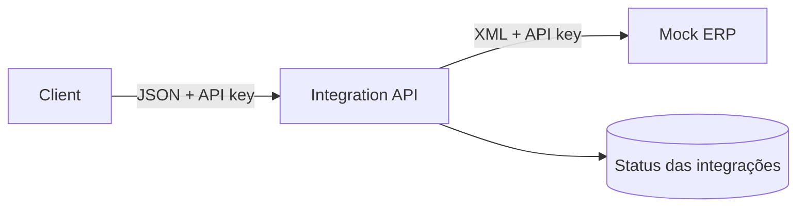

# Integration Lab

Uma API REST em Python que conversa com um ERP legado via XML.

Este projeto demonstra como eu estruturo integrações entre sistemas modernos e
legados: contrato explícito, autenticação, idempotência, retry, tratamento de
erros, logs, testes, Docker e CI.

> Nenhum código ou dado proprietário. O ERP é um serviço simulado criado para o lab.

## Arquitetura



A API recebe JSON, valida com Pydantic, converte para XML e chama o ERP legado.
A resposta XML é convertida de volta para JSON. O status fica em memória nesta
primeira versão.

## Stack

- Python 3.12+
- FastAPI + Pydantic
- httpx
- pytest + ruff
- Docker Compose
- GitHub Actions

## Como rodar

```bash
python -m venv .venv
.venv\Scripts\activate
pip install -e ".[dev]"
```

Rode o ERP simulado:

```bash
uvicorn integration_lab.mock_erp:app --reload --port 8001
```

Em outro terminal, rode a API:

```bash
uvicorn integration_lab.main:app --reload --port 8000
```

Ou rode tudo com Docker:

```bash
docker compose up --build
```

## Exemplo

```bash
curl -X POST http://localhost:8000/api/v1/suppliers \
  -H "Content-Type: application/json" \
  -H "X-API-Key: dev-api-key" \
  -H "Idempotency-Key: supplier-123" \
  -d '{"name":"Fornecedor Exemplo","document":"12345678000199","email":"contato@exemplo.com"}'
```

Resposta:

```json
{
  "integration_id": "4f4f0f0e-7a4d-4c1e-9b0e-2f4c8a1d2e3f",
  "status": "success",
  "erp_id": "ERP-0001"
}
```

## Endpoints

| Método | Rota | Descrição |
| --- | --- | --- |
| GET | `/health` | Health check |
| POST | `/api/v1/suppliers` | Cria um fornecedor no ERP simulado |
| GET | `/api/v1/integrations/{id}` | Consulta o status de uma integração |

A autenticação usa o header `X-API-Key`. A chave padrão de desenvolvimento é
`dev-api-key`; altere com a variável `API_KEY`.

## Idempotência e retry

Envie o header `Idempotency-Key` para tornar o `POST /api/v1/suppliers` seguro
para repetir:

- mesma chave + mesmo payload → devolve o resultado original, sem criar duplicata;
- mesma chave + payload diferente → `409`;
- falha transitória → a chave é liberada para o cliente tentar de novo.

O cliente do ERP tenta novamente em timeout, `429` e `5xx`, com backoff
exponencial e jitter. Erros `4xx` de negócio não são repetidos. As variáveis:

| Variável | Padrão | Descrição |
| --- | --- | --- |
| `ERP_MAX_ATTEMPTS` | `3` | Número máximo de tentativas |
| `ERP_RETRY_BASE_SECONDS` | `0.2` | Espera inicial |
| `ERP_RETRY_MAX_SECONDS` | `2.0` | Espera máxima |

## Tratamento de erros

Os erros seguem um formato inspirado em Problem Details:

```json
{
  "type": "https://integration-lab.dev/errors/erp_unavailable",
  "title": "ERP unavailable",
  "status": 503,
  "detail": "ERP timed out",
  "instance": "/api/v1/suppliers"
}
```

A API diferencia erro de validação (`422`) de falha do ERP (`503`) e registra
cada requisição com um correlation ID (`X-Request-ID`).

## Testes

```bash
pytest
ruff check .
ruff format --check .
```

## Decisões de projeto

- **JSON na borda, XML no limite.** A API pública fica simples; o contrato legado
  fica isolado em um adapter.
- **Idempotência no cliente.** A chave evita duplicidade em retries do cliente.
  Em produção, o ideal é propagar a chave para o ERP ou ter uma checagem de
  duplicidade no destino.
- **Retry só no que é transitório.** Timeout, `429` e `5xx` podem ser repetidos;
  erro de negócio (`4xx`) não.
- **Autenticação entre serviços.** A API e o ERP exigem API key.
- **Logs estruturados.** Os logs incluem request ID e não expõem segredos.
- **Status em memória por enquanto.** O próximo passo é persistir em SQLite ou
  PostgreSQL.

## Próximos passos

- Persistência e histórico de integrações
- Métricas e um dashboard simples
- Testes de contrato contra o ERP simulado
- Outbox pattern ou fila para desacoplar o processamento

## Documentação

- [`docs/como-funciona.md`](docs/como-funciona.md) — explicação em português do
  fluxo, das decisões e dos pontos para estudar antes de uma entrevista.

## Licença

Projeto disponível para estudo e portfólio.
